<!-- A holographic collectible card, No. 101/101. Every graphic is generated from public GitHub data: python3 scripts/build.py --fetch -->

  <a href="https://oshada.dev">
    <picture>
      <source media="(prefers-color-scheme: dark)" srcset="assets/hero-dark.svg">
      
    </picture>
  </a>

  Local-first AI apps, multi-agent systems and machine learning from scratch, plus desktop, Android and web apps.
   
  <b>ABILITIES</b>&ensp;<a href="https://github.com/oshada101/elizabeth">Elizabeth</a> · <a href="https://github.com/oshada101/WCT">WCT</a> · <a href="https://github.com/oshada101/rescueRush">Rescue Rush</a> · <a href="https://github.com/oshada101/heartBeats">heartBeats</a>&emsp;<b>PASSIVE</b>&ensp;<a href="https://github.com/oshada101/neural_network">neural_network</a>

<picture>
  <source media="(prefers-color-scheme: dark)" srcset="assets/title-set-dark.svg">
  
</picture>

  <a href="https://github.com/oshada101/talk"><picture><source media="(prefers-color-scheme: dark)" srcset="assets/set-talk-dark.svg"></picture></a>
  <a href="https://github.com/oshada101/mnemo"><picture><source media="(prefers-color-scheme: dark)" srcset="assets/set-mnemo-dark.svg"></picture></a>
  <a href="https://github.com/oshada101/pyVidSync"><picture><source media="(prefers-color-scheme: dark)" srcset="assets/set-pyvidsync-dark.svg"></picture></a>
  <a href="https://github.com/oshada101/smart-campus-os"><picture><source media="(prefers-color-scheme: dark)" srcset="assets/set-campus-dark.svg"></picture></a>

<picture>
  <source media="(prefers-color-scheme: dark)" srcset="assets/title-trade-dark.svg">
  
</picture>

  <a href="https://oshada.dev"><picture><source media="(prefers-color-scheme: dark)" srcset="assets/trade-site-dark.svg"></picture></a>
  <a href="mailto:oshada1188@gmail.com"><picture><source media="(prefers-color-scheme: dark)" srcset="assets/trade-mail-dark.svg"></picture></a>
  <a href="https://www.linkedin.com/in/oshada-bandara-595b31394"><picture><source media="(prefers-color-scheme: dark)" srcset="assets/trade-linkedin-dark.svg"></picture></a>

READ THE CARD AS TEXT

 

**Oshada Bandara** · Builder, AI / ML · No. 101/101 · **4,159 XP**, his contributions over the last twelve months

**Abilities**

- [**Elizabeth**](https://github.com/oshada101/elizabeth): chat with your documents through a local or hosted LLM. Electron.
- [**WCT**](https://github.com/oshada101/WCT): multi-agent AI that identifies wildlife, tracks migrations and flags threats.
- [**Rescue Rush**](https://github.com/oshada101/rescueRush): real-time ambulance dispatch on a live map.
- [**heartBeats**](https://github.com/oshada101/heartBeats): Android workouts; a BLE heart-rate sensor and Q-learning playlist ordering.

**Passive: [neural_network](https://github.com/oshada101/neural_network).** Each ability you play makes the next one stronger. A feedforward neural network in pure NumPy.

**The set:** [talk](https://github.com/oshada101/talk) (hotkey speech-to-text that types into any app) · [mnemo](https://github.com/oshada101/mnemo) (SM-2 spaced-repetition flashcards) · [pyVidSync](https://github.com/oshada101/pyVidSync) (watch-together synced video player) · [smart-campus-os](https://github.com/oshada101/smart-campus-os) (room booking, resources and ticketing)

**Trade:** [oshada.dev](https://oshada.dev) · [oshada1188@gmail.com](mailto:oshada1188@gmail.com) · [LinkedIn](https://www.linkedin.com/in/oshada-bandara-595b31394)

> *Turning ideas into reality.*

The art is generated from his real contribution calendar: one ridgeline per week, 53 weeks, oldest at the back.

